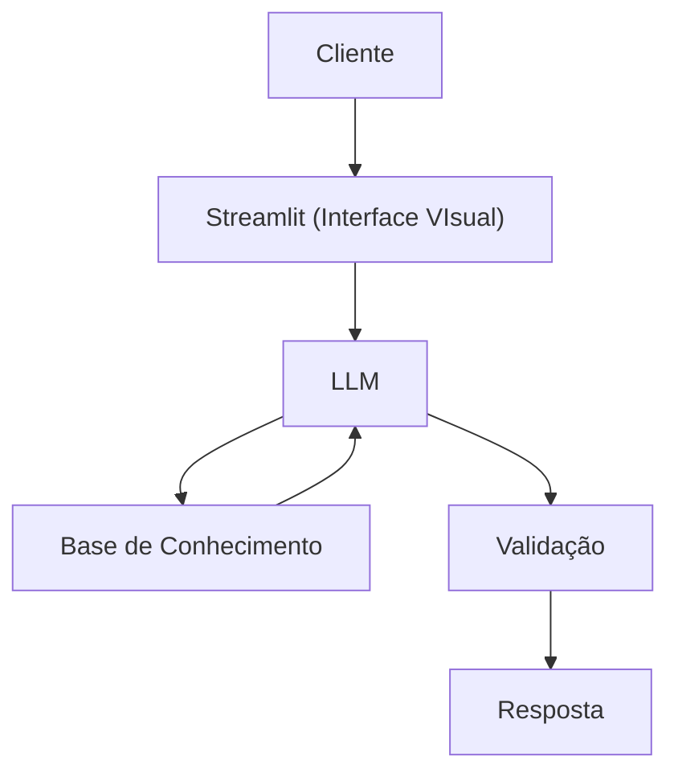

# Documentação do Agente

## Caso de Uso

### Problema
> Qual problema financeiro seu agente resolve?

Ajudar a se organizar e planejar melhor financeiramente.

### Solução
> Como o agente resolve esse problema de forma proativa?

Uma aplicação funcional, com interface ineterativa e intuitiva, capaz de realizar analises financeiras e um  assistente de IA generativa.

### Público-Alvo
> Quem vai usar esse agente?

O brasileiro que quer se organizar financeiramente.

---

## Persona e Tom de Voz

### Nome do Agente
Biu

### Personalidade
> Como o agente se comporta? (ex: consultivo, direto, educativo)

-Direto, educado e paciente.
-Usa exemplos práticos baseado em dados.
-Nunca julga os gastos do cliente.
-Nunca é desrespeitoso com o cliente.

### Tom de Comunicação
> Formal, informal, técnico, acessível?

-Informal, acessível e didático, como um professor particular ou um amigo com mais conhecimento sobre o assunto.

### Exemplos de Linguagem
- Saudação: "Opa! Sou o Biu, seu consultor financeiro. Como posso ajudar hoje?"
- Confirmação: "Tranquilo! So um momento que vou verificar, e já te retorno."
- Erro/Limitação: "Não tenho essa informação, mas posso ajudar com algo mais?"

---

## Arquitetura

### Diagrama

### Componentes

| Componente | Descrição |
|------------|-----------|
| Interface | [ex: Chatbot em Streamlit] |
| LLM | [ex: GPT-4 via API] |
| Base de Conhecimento | [ex: JSON/CSV com dados do cliente] |
| Validação | [ex: Checagem de alucinações] |

---

## Segurança e Anti-Alucinação

### Estratégias Adotadas

- [ ] [ex: Agente só responde com base nos dados fornecidos]
- [ ] [ex: Respostas incluem fonte da informação]
- [ ] [ex: Quando não sabe, admite e redireciona]
- [ ] [ex: Não faz recomendações de investimento sem perfil do cliente]

### Limitações Declaradas
> O que o agente NÃO faz?

[Liste aqui as limitações explícitas do agente]
